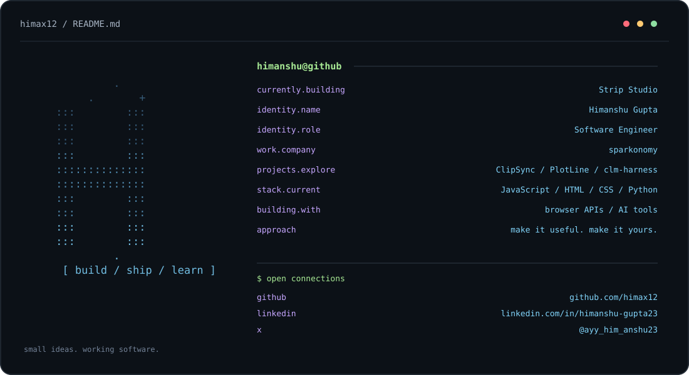

  

  <a href="https://himax12.github.io/strip-studio/">Try Strip Studio</a> &nbsp; / &nbsp;
  <a href="https://www.linkedin.com/in/himanshu-gupta23/">LinkedIn</a> &nbsp; / &nbsp;
  <a href="https://x.com/ayy_him_anshu23">X</a> &nbsp; / &nbsp;
  <a href="https://github.com/himax12?tab=repositories">Repositories</a>

### Currently building

**[Strip Studio](https://himax12.github.io/strip-studio/)** - turn your photos into strips and portrait sets. Crop, arrange, and export in your browser. Your photos stay on your device.

### Other experiments

| Project | What it explores |
| :--- | :--- |
| [ClipSync](https://github.com/himax12/ClipSync) | Matching B-roll to A-roll with a vision-language model. |
| [PlotLine](https://github.com/himax12/PlotLine) | Story generation with symbolic reasoning and language models. |
| [clm-harness](https://github.com/himax12/clm-harness) | A Bash-only coding-agent harness where the model manages its own context by editing a file. |

---

Built with curiosity. Updated by a human (and sometimes an agent).
